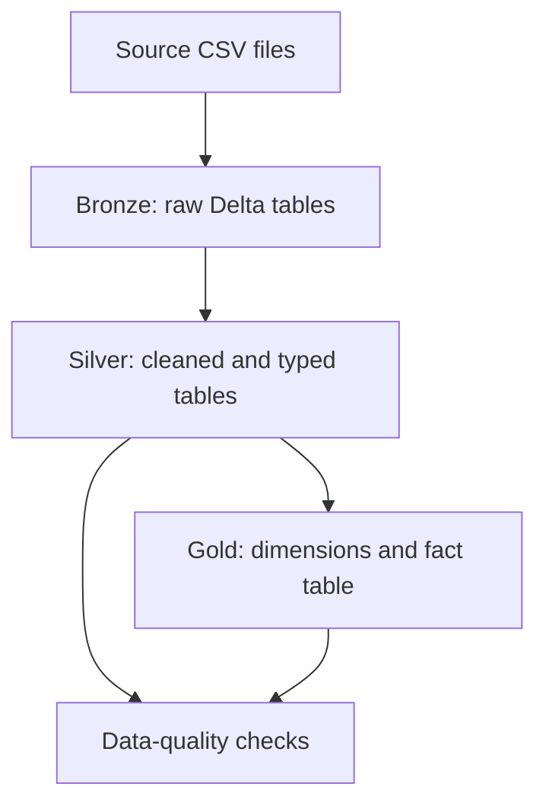

# global-sales-logistics-lakehouse
Global Sales Repository for big data analysis using Databricks

An end-to-end data engineering portfolio project built with **Databricks, Apache Spark, Delta Lake, and SQL**. The project transforms raw sales, customer, product, and order CSV files into curated analytics tables and an executive dashboard using a Medallion-style architecture.

> **Project status:** Bronze, Silver, and Gold data layers are implemented; core data-quality checks have passed; an executive AI/BI dashboard has been published; and Delta Lake `MERGE` behavior has been demonstrated in isolated test tables.

## Table of Contents

- [Business Objective](#business-objective)
- [Architecture](#architecture)
- [Technology Stack](#technology-stack)
- [Data Sources](#data-sources)
- [Data Model](#data-model)
- [Data Quality and Validation](#data-quality-and-validation)
- [Business Insights](#business-insights)
- [Dashboard](#dashboard)
- [Incremental Processing Experiment](#incremental-processing-experiment)
- [Repository Structure](#repository-structure)
- [How to Reproduce](#how-to-reproduce)
- [Limitations and Future Improvements](#limitations-and-future-improvements)

## Business Objective

Build a maintainable analytics foundation for exploring sales performance and shipping operations across customers, products, orders, countries, markets, and regions.

The pipeline separates raw ingestion, data cleaning, and business-ready modelling so that analytical queries and dashboard metrics are based on curated tables rather than raw CSV files.

## Architecture



### Bronze — Raw ingestion

The source CSV files are stored in a Unity Catalog Volume and ingested into Delta tables.

| Table | Rows |
|---|---:|
| `bronze_clientes` | 1,590 |
| `bronze_pedidos` | 25,036 |
| `bronze_produtos` | 10,293 |
| `bronze_vendas` | 51,290 |

### Silver — Cleansing and standardisation

The Silver layer applies data preparation and type conversion, including:

- Removal of exact duplicate records where identified.
- Parsing order and shipping dates.
- Conversion of sales and shipping-cost fields from comma-decimal text into `DECIMAL(18,3)`.
- Conversion of sold quantity to an integer.
- Validation of shipping dates and required values.
- Referential-integrity checks from sales to customers, orders, and products.

| Table | Rows | Notes |
|---|---:|---|
| `silver_clientes` | 1,590 | Unique customer IDs |
| `silver_pedidos` | 25,035 | One exact duplicate removed; dates parsed |
| `silver_produtos` | 10,292 | One exact duplicate removed; unique product IDs |
| `silver_vendas` | 51,290 | Numeric fields typed and validated |

### Gold — Analytics model

The Gold layer contains dimensions and a sales fact table for reporting.

| Table | Rows | Purpose |
|---|---:|---|
| `dim_cliente` | 1,590 | Customer, segment, geography, market, and region |
| `dim_produto` | 10,292 | Product category, subcategory, and name |
| `dim_pedido` | 25,035 | Order dates, shipping mode, priority, and shipping lead time |
| `dim_data` | 1,428 | Distinct order dates for date-oriented analysis |
| `fact_vendas` | 51,290 | Sales value, quantity, shipping cost, and descriptive attributes |

**Current modelling note:** the fact table includes business identifiers and descriptive attributes joined from the dimensions. A future refinement could keep the fact table narrower and use explicit dimension-key relationships, depending on reporting needs and the intended star-schema design.

## Technology Stack

- **Databricks Free Edition** — development and analytics workspace
- **Apache Spark SQL** — transformation and validation queries
- **Delta Lake** — managed tables and `MERGE` experiment
- **Unity Catalog** — catalog, schema, and Volume organisation
- **Databricks AI/BI Dashboards** — executive reporting
- **GitHub** — project documentation and portfolio presentation

## Data Sources

The source files are:

- `Clientes.csv`
- `Pedidos.csv`
- `Produtos.csv`
- `Vendas.csv`

They are stored in the Databricks Volume:

`/Volumes/first_catalog/default/logistica_vol/`

The project uses the catalog and schema `first_catalog.default`.

## Data Model

### Dimensions

- **`dim_cliente`**: `id_cliente`, `nome_cliente`, `segmento`, `cidade`, `estado`, `pais`, `mercado`, `regiao`
- **`dim_produto`**: `id_produto`, `categoria`, `subcategoria`, `nome_produto`
- **`dim_pedido`**: `id_pedido`, `data_pedido`, `data_envio`, `modo_envio`, `prioridade_pedido`, `dias_para_envio`
- **`dim_data`**: distinct order dates

### Fact table

`fact_vendas` contains 51,290 rows and includes order, customer, and product identifiers alongside sales value, sold quantity, shipping cost, and selected customer, product, and shipping attributes.

The source data does not explicitly identify a currency, so sales values should be treated as source-denominated amounts. Shipping cost is retained as a supplied measure; this project does not infer profit or margin from it.

## Data Quality and Validation

The implemented checks include:

- Unique business identifiers in customer, product, and order dimensions.
- Null checks for required fact-table keys and fields.
- Positive-value checks for relevant sales measures.
- Referential-integrity checks from sales to customer, order, and product dimensions.
- Row-count checks before and after joins to ensure that the Gold fact-table row count was preserved.
- Duplicate checks for customer, product, and order identifiers.

### Final validation snapshot

| Check | Expected / observed result |
|---|---:|
| `dim_cliente` rows / unique IDs | 1,590 / 1,590 |
| `dim_produto` rows / unique IDs | 10,292 / 10,292 |
| `dim_pedido` rows / unique IDs | 25,035 / 25,035 |
| `fact_vendas` rows | 51,290 |
| Null fact keys in the quality check | 0 |
| Missing customer references | 0 |
| Missing order references | 0 |
| Missing product references | 0 |
| Invalid/non-positive values in the checked measures | 0 |

The fact-table count check confirms the expected row volume. It does **not** prove that every sales line has a unique natural key; a stable sales-line key still needs to be identified or defined before asserting fact-row uniqueness.

## Business Insights

The curated data supports analysis of sales by country, month, product subcategory, and shipping mode.

### Overall metrics

| Metric | Result |
|---|---:|
| Sales lines | 51,290 |
| Distinct orders | 25,035 |
| Distinct customers | 1,590 |
| Distinct products | 10,292 |
| Total sales value (source currency unspecified) | 12,642,502.22 |
| Units sold | 178,312 |
| Average sales value per line | 246.49 |
| Average days until shipping | 3.96 |

### Sales trend by year

| Year | Sales value | Year-over-year change |
|---|---:|---:|
| 2011 | 2,259,450.95 | — |
| 2012 | 2,677,438.75 | +18.50% |
| 2013 | 3,405,746.55 | +27.20% |
| 2014 | 4,299,865.98 | +26.25% |

Sales value increased by approximately 90.3% between 2011 and 2014 in the available dataset. This is a descriptive observation, not evidence of the cause of the increase.

### Example product and country observations

- The United States has the highest total sales value in the available country summary: **2,545,193.00**.
- The Phones subcategory has the highest total sales value among the analysed subcategories: **1,706,824.18**.
- Standard Class accounts for 14,953 orders, with an average of approximately 5.00 days until shipping.
- The overall average time until shipping is approximately 3.96 days.

The source does not identify currency, and the project does not calculate profit or margin. Shipping-mode and order-priority comparisons are descriptive and should not be interpreted as causal effects.

## Dashboard

The published Databricks AI/BI dashboard is named **Global Sales & Logistics - Executive Overview**.

It includes KPI cards for:

- Total sales value
- Distinct orders
- Units sold
- Average days until shipping

It also includes visualisations for sales by country, monthly sales trend, and sales by product subcategory. A shipping-mode analysis can be included as an additional logistics view if it is not already present.

> Add a dashboard screenshot to this repository before publishing the project. Suggested location: `images/Dashboard.png`.

## Incremental Processing Experiment

A controlled experiment was performed in separate test tables to demonstrate Delta Lake `MERGE` behavior:

- Update a matching customer only when tracked values differ.
- Insert a new customer when its business key is absent from the target.
- Compare total rows and distinct keys after the merge.
- Re-run unchanged input and verify that no additional rows are inserted and no unnecessary updates are performed.

The test successfully updated one simulated customer and inserted one synthetic test customer while preserving unique IDs.

**Scope clarification:** this is a validated `MERGE` experiment, not a fully automated incremental ingestion framework. The current CSV-based pipeline does not yet implement source change detection, batch tracking, orchestration, or a production-grade incremental strategy.

## Repository Structure

Suggested repository layout:

```text
global-sales-logistics-lakehouse/
├── README.md
├── notebooks/
│   ├── 01_bronze_ingestion
│   ├── 02_silver_transformations
│   ├── 03_gold_model
│   └── 04_gold_quality_checks
└── images/
    └── executive-dashboard.png
```

Export the Databricks notebooks into this repository and adjust filenames to match the actual exported files. Do not commit credentials, tokens, private data, or any files that should not be publicly shared.

## How to Reproduce

1. Create or select a Databricks workspace with Unity Catalog support.
2. Create the catalog/schema and a Volume for the source files.
3. Upload the four CSV files to the configured Volume path.
4. Run the Bronze ingestion notebook.
5. Run the Silver transformation notebook.
6. Run the Gold modelling notebook.
7. Run the Gold data-quality checks.
8. Create or refresh the AI/BI dashboard using the Gold tables.

The exact notebook names and execution order should be aligned with the notebooks exported to the repository.

## Limitations and Future Improvements

- Define a stable, business-appropriate key for individual sales lines and test fact-table uniqueness.
- Add incremental ingestion with explicit batch metadata or source change detection.
- Parameterise paths and environment-specific catalog/schema names.
- Add automated data-quality assertions that fail the pipeline when critical checks do not pass.
- Add orchestration, monitoring, and operational logging.
- Review whether the Gold fact table should contain dimension surrogate keys and fewer descriptive attributes.
- Document metric definitions and add dashboard filters for time, market, country, and product category.
- Add screenshots and exported notebooks to make the project reproducible for reviewers.

## Author

Add your name and portfolio links here:

- **LinkedIn:** `(https://www.linkedin.com/in/zingafirminorene/)`
- **GitHub:** `(https://github.com/ZingaRene)`

---

*Built as a hands-on Data Engineering portfolio project focused on layered data architecture, Delta Lake transformations, data quality, analytical modelling, and business reporting.*
